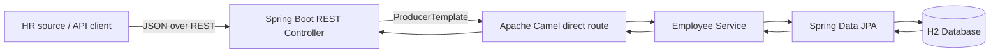

# Employee Integration Demo

A portfolio project demonstrating a REST-based employee-data integration using **Java 17, Spring Boot, Apache Camel, Spring Data JPA and H2**.

> This is a Workday-style integration simulation. It does not connect to a Workday tenant or use real employee data.

## Architecture



## What it demonstrates

- REST endpoints to create, update, retrieve, list and delete employee records.
- Apache Camel routes as an integration layer between the API and business service.
- Request validation and HTTP error mapping.
- JPA persistence and a unique employee business ID.
- A small integration test that exercises the Camel routes.
- An in-memory H2 database for easy local execution.

## Requirements

- JDK 17+
- Maven 3.9+

## Run locally

```bash
mvn spring-boot:run
```

The API starts at `http://localhost:8080`.

Run tests:

```bash
mvn test
```

## API examples

### Create an employee

```bash
curl -i -X POST http://localhost:8080/api/employees \
  -H "Content-Type: application/json" \
  -d '{
    "employeeId": "EMP-1001",
    "fullName": "Alex Example",
    "email": "alex.example@example.com",
    "department": "Engineering",
    "employmentStatus": "ACTIVE"
  }'
```

Expected response: `201 Created`, with the stored employee JSON.

### Retrieve one employee

```bash
curl -i http://localhost:8080/api/employees/EMP-1001
```

### List employees

```bash
curl -i http://localhost:8080/api/employees
```

### Update an employee

The ID in the URL and body must match.

```bash
curl -i -X PUT http://localhost:8080/api/employees/EMP-1001 \
  -H "Content-Type: application/json" \
  -d '{
    "employeeId": "EMP-1001",
    "fullName": "Alex Example",
    "email": "alex.updated@example.com",
    "department": "Platform Engineering",
    "employmentStatus": "ACTIVE"
  }'
```

### Delete an employee

```bash
curl -i -X DELETE http://localhost:8080/api/employees/EMP-1001
```

Expected response: `204 No Content`.

## Route overview

| Camel route | Purpose |
|---|---|
| `direct:employee-create` | Validate uniqueness and persist a new employee |
| `direct:employee-update` | Update an existing employee |
| `direct:employee-get` | Retrieve one employee by business ID |
| `direct:employee-list` | Retrieve all employees |
| `direct:employee-delete` | Delete an employee |

The REST controller uses Camel's `ProducerTemplate` to invoke the `direct:` routes. Each route calls the employee service, which uses Spring Data JPA for database operations.

## Suggested next improvements

1. Add an inbound Workday-compatible payload mapper and separate source DTO from the internal employee model.
2. Add idempotency or upsert handling for replayed events.
3. Add audit fields and correlation IDs for tracing.
4. Add authentication/authorization and secret management before any real deployment.
5. Replace H2 with PostgreSQL for a persistent database.
6. Add a messaging route (Kafka or a cloud queue) and retry/dead-letter handling for asynchronous updates.

## Portfolio wording

Suggested description:

> Built a sample employee-data integration using Java, Spring Boot and Apache Camel. Exposes REST endpoints for employee create/update/delete/retrieval, routes requests through Camel integration flows, validates payloads and persists records through Spring Data JPA. Includes automated route tests and API examples.

Describe this repository as a **demonstration project**. Keep it separate from any Workday integration work you performed professionally.
